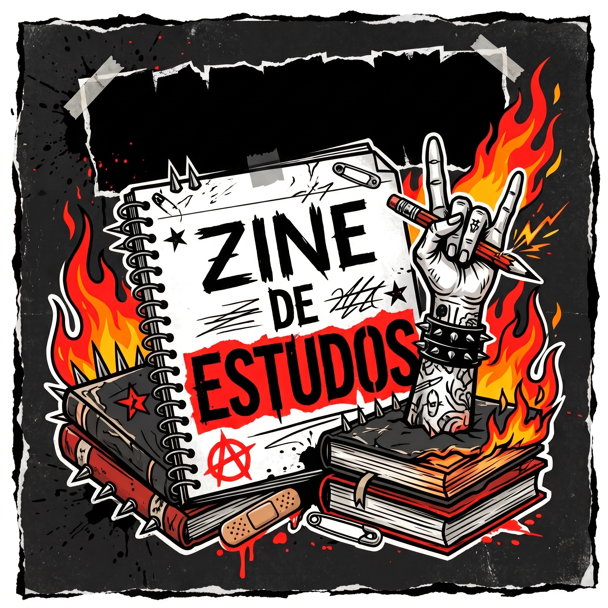
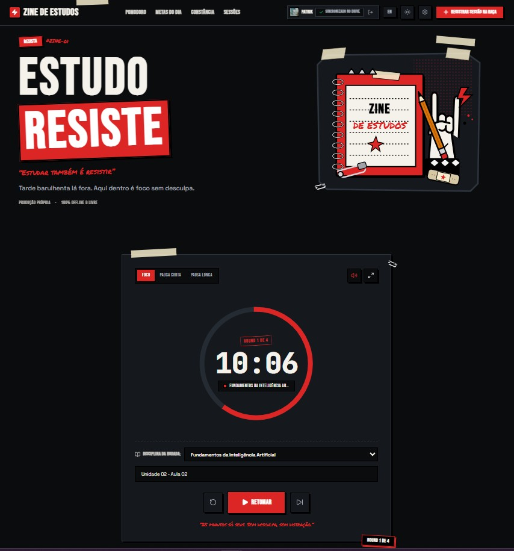
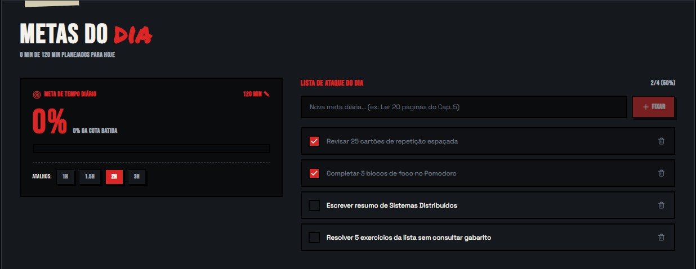
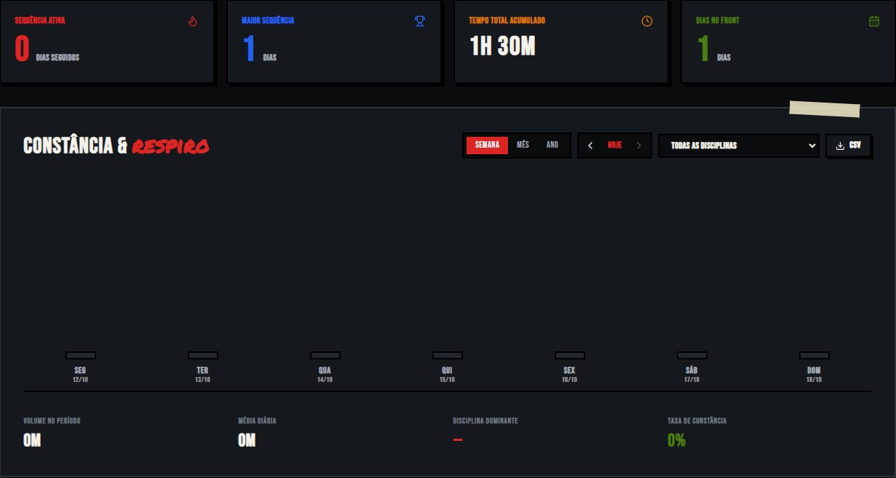
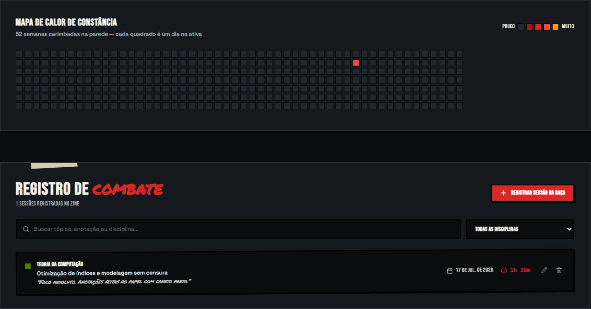

<p align="center">
  
</p>

<h1 align="center">⚡️ Zine de Estudos ⚡️</h1>

<p align="center">
  <em>"Estudar também é resistir."</em><br>
  Uma plataforma de produtividade e organização de rotina de estudos com atitude, feita para manter o foco sem desculpas.
</p>

<p align="center">
  <a href="https://zine-de-estudos.vercel.app/#" target="_blank">
    
  </a>
</p>

---

## 📖 Sobre o Projeto

O **Zine de Estudos** é um projeto pessoal criado para ajudar estudantes a organizarem suas rotinas de estudo de forma prática e visual. Inspirado na estética dos *zines* underground e do movimento punk, o projeto foge do padrão corporativo e traz um ambiente de "combate" contra a procrastinação, utilizando o **Método Pomodoro** como base para o gerenciamento de tempo.

👉 **Teste agora mesmo (não precisa instalar nada):** [zine-de-estudos.vercel.app](https://zine-de-estudos.vercel.app/#)

## 🚀 Principais Funcionalidades

- 🍅 **Timer Pomodoro (Foco sem desculpa):** Ciclos personalizáveis de Foco, Pausa Curta e Pausa Longa.
- 🎯 **Metas do Dia (Lista de Ataque):** Defina um tempo diário a ser batido e crie uma lista de tarefas (to-do list) para a sua sessão de estudos.
- 🔥 **Constância & Mapa de Calor:** Acompanhe sua ofensiva de estudos! Um mapa de calor de 52 semanas carimba na parede os dias em que você esteve na ativa, além de registrar sua maior sequência e tempo total acumulado.
- 📓 **Registro de Combate (Histórico):** Todo o histórico das suas sessões de estudo fica salvo, permitindo visualizar disciplinas, anotações e o tempo investido em cada tópico.
- ☁️ **Sincronização:** Suporte para backup no Google Drive, garantindo que seu progresso não se perca.
- 🌑 **Dark Mode & Acessibilidade:** Interface escura confortável para longas sessões na madrugada, modo tela cheia e controle de volume para alertas.

---

## 📸 Interface e Telas

*(Aqui continuam as imagens que geramos anteriormente...)*
### Painel Principal e Pomodoro


### Metas do Dia e Acompanhamento


### Estatísticas e Constância


### Mapa de Calor e Histórico (Registro de Combate)


---

## 🛠️ Tecnologias Utilizadas

- **Front-end:** React / TypeScript / Vite / Tailwind CSS *(ajuste conforme necessário)*
- **Ícones/Design:** Estética Zine/DIY (Produção própria)
- **Hospedagem:** Vercel
    
---

## 💻 Para Desenvolvedores (Rodando Localmente)

Se você é desenvolvedor e deseja rodar o projeto na sua máquina para estudar o código ou fazer modificações:

1. Clone o repositório:
```bash
git clone [https://github.com/SEU_USUARIO/zine-de-estudos.git](https://github.com/SEU_USUARIO/zine-de-estudos.git)
